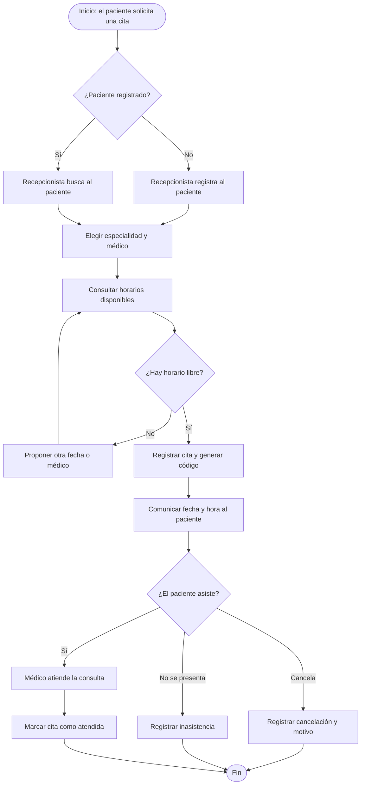
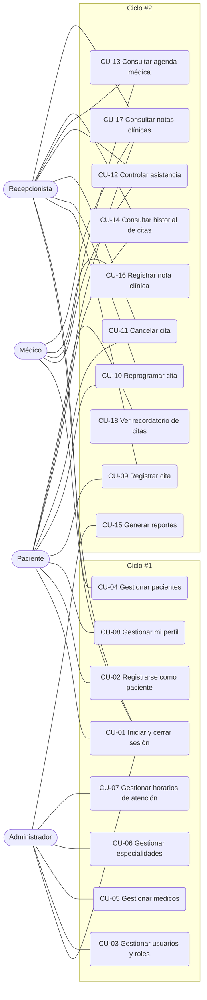

# SISTEMA WEB PARA LA GESTIÓN DE CITAS MÉDICAS — CLÍNICA VIDA SALUD

| | |
|---|---|
| **Materia** | Ingeniería de Requisitos — SC |
| **Examen** | Segundo Examen Parcial |
| **Grupo** | SC |
| **Integrante** | Einar Padilla Delgadillo |
| **Docente** | Angeliza Garzon Cuellar |
| **Presentación** | 1 — Ciclo #1 (24/10/2026) |
| **Repositorio** | URL + Código QR (completar) |

---

## Tabla de contenido

> Actualizar en cada presentación.

1. [Perfil](#1-perfil)
2. [Marco teórico](#2-marco-teórico)
3. [Modelo de negocio](#3-modelo-de-negocio)
4. [FT. Captura de requisitos](#4-ft-captura-de-requisitos)
5. [FT. Análisis](#5-ft-análisis)
6. [FT. Diseño](#6-ft-diseño)
7. [FT. Implementación](#7-ft-implementación)
8. [FT. Pruebas](#8-ft-pruebas)
9. [Conclusión](#conclusión)
10. [Recomendación](#recomendación)
11. [Bibliografía](#bibliografía)
12. [Anexos](#anexos)

---

## 1. Perfil

### 1.1 Introducción

La Clínica Vida Salud es un establecimiento médico privado (ficticio) que brinda atención en medicina general, pediatría, ginecología y odontología. Hoy gestiona sus citas con cuadernos, llamadas telefónicas y hojas de cálculo, lo que dificulta organizar los horarios de los médicos, controlar las citas programadas y mantener actualizados los datos de los pacientes.

La dirección de la clínica ha decidido implementar un sistema web que centralice la información y automatice los principales procesos de gestión de citas médicas. El sistema se desarrollará con PHP y PostgreSQL, bajo el enfoque del Proceso Unificado de Desarrollo de Software con UML (PUDS-UML), organizado en dos ciclos de desarrollo.

### 1.2 Objetivos

#### Objetivo general

Desarrollar un sistema web de gestión de citas médicas utilizando PHP como lenguaje del lado del servidor y PostgreSQL como sistema gestor de base de datos, con el propósito de mejorar el registro, la programación, el seguimiento y el control de las citas médicas de la Clínica Vida Salud.

#### Objetivos específicos

- Analizar los procesos de registro y programación de citas de la clínica.
- Diseñar una base de datos relacional con tablas relacionadas mediante claves primarias y foráneas.
- Implementar formularios para el registro, consulta, modificación y desactivación de pacientes y médicos.
- Gestionar las especialidades médicas y los horarios de atención.
- Programar citas verificando la disponibilidad del médico.
- Controlar los estados de las citas médicas.
- Generar reportes de citas por fecha, médico, especialidad y estado.
- Aplicar validaciones de datos y mecanismos básicos de seguridad.
- Realizar pruebas para verificar el correcto funcionamiento del sistema.

### 1.3 Descripción del problema

El registro manual de citas ha generado los siguientes problemas:

1. Duplicación de citas para un mismo médico y horario.
2. Pérdida o registro incorrecto de los datos de los pacientes.
3. Dificultad para conocer los horarios disponibles de los médicos.
4. Falta de control sobre las citas canceladas y las inasistencias.
5. Demoras en la búsqueda del historial de citas de un paciente.
6. Dificultad para obtener reportes de las atenciones programadas.
7. Falta de información actualizada para la administración de la clínica.

**Planteamiento:** ¿cómo desarrollar un sistema web con PHP y PostgreSQL que permita administrar pacientes, médicos, especialidades y citas médicas, evitando conflictos de horarios y facilitando el control de las atenciones de la Clínica Vida Salud?

### 1.4 Alcance

El sistema es una aplicación web accesible desde un navegador (PHP, PostgreSQL, HTML, CSS y JavaScript para la interacción de los formularios), destinada principalmente al personal administrativo de la clínica.

**El sistema permite:**

- Registrar y consultar pacientes.
- Registrar médicos y sus especialidades.
- Definir horarios de atención.
- Consultar disponibilidad de citas.
- Registrar, reprogramar y cancelar citas.
- Registrar la asistencia o inasistencia del paciente.
- Consultar el historial de citas.
- Generar reportes administrativos.
- Administrar usuarios y permisos básicos.

**Roles:** Administrador, Recepcionista, Médico y Paciente.

**Desarrollo por ciclos:**

| Ciclo | Requisitos | Estado |
|---|---|---|
| Ciclo #1 | RF01 Login y roles · RF02 Pacientes · RF03 Médicos · RF04 Especialidades · RF05 Horarios | En curso |
| Ciclo #2 | RF06–RF13 Citas, anti-duplicados, reprogramación, cancelación, asistencia, agenda, historial, reportes | Pendiente |

---

## 2. Marco teórico

<!-- PUDS-UML, aplicaciones web, PHP, PostgreSQL, PDO, sesiones y hash de contraseñas, RBAC, etc. -->

---

## 3. Modelo de negocio

### 3.1 Descripción del negocio

La Clínica Vida Salud presta servicios de consulta médica en distintas especialidades (medicina general, pediatría, ginecología, odontología, entre otras). El negocio gira en torno a un proceso central: **el paciente solicita una atención, la recepción le asigna una cita con un médico disponible y el médico lo atiende en la fecha y hora acordadas**.

Hoy ese proceso se apoya en cuadernos, llamadas telefónicas y hojas de cálculo, lo que produce citas duplicadas, datos de pacientes perdidos o incorrectos, falta de control de cancelaciones e inasistencias y dificultad para obtener reportes.

**Procesos principales del negocio:**

1. Registrar y mantener los datos de los pacientes.
2. Administrar médicos, especialidades y horarios de atención.
3. Programar, reprogramar y cancelar citas.
4. Atender la consulta y registrar la asistencia.
5. Emitir reportes para la administración.

### 3.2 Actores del negocio

| Actor | Tipo | Responsabilidad en el negocio |
|---|---|---|
| **Paciente** | Actor externo (cliente) | Solicita atención médica, asiste a su cita o la cancela. |
| **Recepcionista** | Trabajador del negocio | Registra pacientes, consulta disponibilidad, programa, reprograma y cancela citas, registra asistencia. |
| **Médico** | Trabajador del negocio | Atiende las consultas y consulta su agenda de citas. |
| **Administrador** | Trabajador del negocio | Gestiona usuarios, médicos, especialidades y horarios; supervisa los reportes. |

### 3.3 Casos de uso del negocio

| Código | Caso de uso del negocio | Actores |
|---|---|---|
| CUN-01 | Registrar paciente | Paciente, Recepcionista |
| CUN-02 | Administrar médicos, especialidades y horarios | Administrador |
| CUN-03 | Programar cita médica | Paciente, Recepcionista |
| CUN-04 | Reprogramar o cancelar cita | Paciente, Recepcionista |
| CUN-05 | Atender consulta médica | Paciente, Médico |
| CUN-06 | Registrar asistencia o inasistencia | Recepcionista |
| CUN-07 | Emitir reportes administrativos | Administrador |

### 3.4 Diagrama de actividades / procesos del negocio

Proceso: **Programar cita médica** (CUN-03).

### 3.5 Reglas del negocio

Se aplican independientemente de lo que el usuario escriba en los formularios.

| Código | Regla |
|---|---|
| RN01 | Cada paciente tendrá un identificador único. |
| RN02 | Cada médico tendrá un identificador único. |
| RN03 | Una cita deberá estar asociada a un paciente y a un médico válidos. |
| RN04 | El médico deberá estar activo para recibir nuevas citas. |
| RN05 | La cita deberá pertenecer al horario de atención del médico. |
| RN06 | No se podrán registrar citas en fechas pasadas. |
| RN07 | Un médico no podrá tener citas superpuestas. |
| RN08 | La duración de la cita deberá respetar la configuración del sistema. |
| RN09 | Las citas canceladas no ocuparán disponibilidad. |
| RN10 | Las citas atendidas conservarán su registro histórico. |
| RN11 | No se eliminarán pacientes o médicos con citas históricas asociadas; se desactivarán. |
| RN12 | Solo los usuarios autorizados podrán realizar cada operación. |
| RN13 | La programación y reprogramación verificarán la disponibilidad en el servidor. |
| RN14 | Los datos se almacenarán de forma persistente en PostgreSQL. |

---

## 4. FT. Captura de requisitos

### 4.1 Requisitos funcionales

RF01 a RF13 provienen del enunciado. **RF14 a RF16 son derivados** del punto 3.4 del enunciado (perfil del paciente). Además, RF06, RF08, RF09 y RF12 se extienden para que el Paciente opere sobre **sus propias** citas.

| Código | Requisito | Origen | Ciclo |
|---|---|---|---|
| RF01 | Inicio de sesión y control de acceso por rol | Enunciado | 1 |
| RF02 | Gestión de pacientes (registrar, listar, buscar, modificar, desactivar) | Enunciado | 1 |
| RF03 | Gestión de médicos | Enunciado | 1 |
| RF04 | Gestión de especialidades médicas | Enunciado | 1 |
| RF05 | Gestión de horarios de atención y duración de cita | Enunciado | 1 |
| RF14 | Cuenta y perfil del paciente: registro propio con datos mínimos, vínculo con su ficha, y consulta de su información médica y contacto de emergencia (solo lectura) | Derivado de 3.4 | 1 |
| RF06 | Registro de citas médicas (Recepcionista o Paciente) | Enunciado + 3.4 | 2 |
| RF07 | Prevención de citas duplicadas | Enunciado | 2 |
| RF08 | Reprogramación de citas | Enunciado + 3.4 | 2 |
| RF09 | Cancelación de citas | Enunciado + 3.4 | 2 |
| RF10 | Control de asistencia y estados de la cita | Enunciado | 2 |
| RF11 | Consulta de agenda médica | Enunciado | 2 |
| RF12 | Historial de citas por paciente | Enunciado + 3.4 | 2 |
| RF13 | Reportes | Enunciado | 2 |
| RF15 | Recordatorios de próximas consultas (aviso dentro del sistema) | Derivado de 3.4 | 2 |
| RF16 | Historial médico: notas clínicas por cita atendida | Derivado de 3.4 | 2 |

**Decisiones de alcance** (tomadas para este proyecto, donde el enunciado no es explícito):

- **Registro propio del Paciente:** solo nombre, correo, teléfono y contraseña (la contraseña es necesaria por RF01). El CI y el resto de la ficha los completa la Recepcionista.
- **Vínculo cuenta-ficha:** manual. La Recepcionista completa el CI y vincula la cuenta con la ficha. No hay emparejamiento automático por correo, porque el correo no está verificado (riesgo de acceso a información médica ajena) y es opcional en RF02. Una mejora futura es sugerir la coincidencia por correo para que la Recepcionista la confirme.
- **Información médica y contacto de emergencia:** los registra y edita la Recepcionista. El Paciente los ve en solo lectura. El Médico los ve en solo lectura.
- **Edición del Paciente:** solo teléfono y contraseña. No edita nombre (identidad) ni correo (usuario de acceso).
- **RF15 Recordatorios:** aviso dentro del sistema, sin correo. Al iniciar sesión, el Paciente ve un banner con sus próximas citas (los siguientes 2 días).
- **RF16 Historial médico:** el Médico registra una nota clínica por cada cita atendida con motivo de consulta, diagnóstico, tratamiento o indicaciones, y observaciones. Cada Médico edita solo sus propias notas; al editarla se sobrescribe y se guarda quién y cuándo la modificó por última vez, sin conservar versiones. Ven las notas: el Médico, el Paciente y la Recepcionista, todas en solo lectura salvo el autor.
- **Acceso del Médico:** solo a los pacientes que tienen o tuvieron cita con él; ve sus datos básicos, información médica, contacto de emergencia y las notas clínicas, incluidas las de otros médicos.
- **Modalidad:** la cita tiene un campo `modalidad` (presencial o virtual).
- **Sucursal:** la base de datos incluye la tabla `sucursales` con una sola sucursal cargada y `sucursal_id` en horarios de atención y citas, para poder escalar. No hay pantalla de gestión de sucursales. El `consultorio` se registra en el horario de atención. No hay filtro por ubicación.

### 4.2 Requisitos no funcionales

| Código | Categoría | Requisito |
|---|---|---|
| RNF01 | Tecnología | Backend en PHP, base de datos PostgreSQL y conexión mediante PDO (`pdo_pgsql`). |
| RNF02 | Tecnología | Frontend con HTML5 y CSS3; JavaScript para validaciones e interacción. |
| RNF03 | Despliegue | Ejecución en servidor local Apache (XAMPP o entorno PHP equivalente). |
| RNF04 | Seguridad | Contraseñas almacenadas con `password_hash()` y verificadas con `password_verify()`. |
| RNF05 | Seguridad | Consultas SQL parametrizadas para evitar inyección SQL. |
| RNF06 | Seguridad | Uso de sesiones; las páginas internas rechazan el acceso sin sesión válida. |
| RNF07 | Seguridad | Los errores no muestran credenciales ni detalles internos al usuario. |
| RNF08 | Integridad | Validación de datos en cliente y en servidor. |
| RNF09 | Datos | Base de datos normalizada, sin duplicación innecesaria. |
| RNF10 | Mantenibilidad | Separación razonable entre interfaz, lógica de negocio y acceso a datos. |
| RNF11 | Mantenibilidad | Código comentado, con buenas prácticas, publicado en GitHub. |
| RNF12 | Usabilidad | Diseño profesional y mensajes de error comprensibles. |

### 4.3 Actores del sistema

| Actor | Descripción | Origen |
|---|---|---|
| **Administrador** | Configura y supervisa el sistema: usuarios, roles, médicos, especialidades, horarios y reportes. | Enunciado 3.1 |
| **Recepcionista** | Gestiona pacientes (incluida su información médica y contacto de emergencia), vincula cuentas con fichas, gestiona citas y registra asistencia. | Enunciado 3.2 |
| **Médico** | Consulta su agenda, marca citas atendidas y registra sus notas clínicas. | Enunciado 3.3 |
| **Paciente** | Tiene cuenta propia; ve su perfil e información médica en solo lectura, edita su teléfono y contraseña, y gestiona sus propias citas. | Enunciado 3.4 |

### 4.4 Diagrama de casos de uso

### 4.5 Priorización y selección de casos de uso por ciclo

| Caso de uso | RF | Prioridad | Ciclo | Justificación |
|---|---|---|---|---|
| CU-01 Iniciar y cerrar sesión | RF01 | Alta | 1 | Base de seguridad; todo lo demás depende de él. |
| CU-02 Registrarse como paciente | RF14 | Alta | 1 | Permite que el Paciente tenga cuenta. |
| CU-03 Gestionar usuarios y roles | RF01 | Alta | 1 | Habilita al personal y sus permisos. |
| CU-04 Gestionar pacientes | RF02, RF14 | Alta | 1 | Dato maestro requerido por las citas; incluye información médica, contacto de emergencia y vínculo de cuenta. |
| CU-05 Gestionar médicos | RF03 | Alta | 1 | Dato maestro requerido por las citas. |
| CU-06 Gestionar especialidades | RF04 | Alta | 1 | Dato maestro requerido por médicos. |
| CU-07 Gestionar horarios de atención | RF05 | Alta | 1 | Define la disponibilidad que usa el Ciclo #2. |
| CU-08 Gestionar mi perfil | RF14 | Media | 1 | Consulta en solo lectura y edición de teléfono y contraseña. |
| CU-09 Registrar cita | RF06, RF07 | Alta | 2 | Núcleo del sistema; depende de CU-04 a CU-07. |
| CU-10 Reprogramar cita | RF08 | Alta | 2 | Depende de CU-09. |
| CU-11 Cancelar cita | RF09 | Alta | 2 | Depende de CU-09. |
| CU-12 Controlar asistencia | RF10 | Alta | 2 | Depende de CU-09. |
| CU-13 Consultar agenda médica | RF11 | Media | 2 | Depende de CU-09. |
| CU-14 Consultar historial de citas | RF12 | Media | 2 | Depende de CU-09. |
| CU-15 Generar reportes | RF13 | Media | 2 | Requiere citas ya registradas. |
| CU-16 Registrar nota clínica | RF16 | Media | 2 | Requiere citas atendidas (CU-12). |
| CU-17 Consultar notas clínicas | RF16 | Media | 2 | Depende de CU-16. |
| CU-18 Ver recordatorio de citas | RF15 | Baja | 2 | Banner al iniciar sesión; depende de CU-09. |

**Criterio:** el Ciclo #1 entrega la base (acceso y datos maestros) y el Ciclo #2 el núcleo de citas, que necesita esa base estable.

### 4.6 Especificación de casos de uso

Se especifican los casos de uso del Ciclo #1. Los del Ciclo #2 se agregan en la segunda presentación.

#### CU-01 Iniciar y cerrar sesión

| | |
|---|---|
| **Actores** | Administrador, Recepcionista, Médico, Paciente |
| **Requisito** | RF01 |
| **Precondición** | El usuario tiene una cuenta activa. |
| **Postcondición** | Existe una sesión válida con el rol del usuario, o la sesión queda cerrada. |

**Flujo principal**
1. El usuario ingresa su nombre de usuario o correo y su contraseña.
2. El sistema valida los datos en el servidor y verifica la contraseña con `password_verify()`.
3. El sistema inicia la sesión e identifica el rol.
4. El sistema muestra el menú correspondiente al rol.
5. El usuario cierra la sesión y el sistema la destruye.

**Flujos alternos**
- 2a. Credenciales incorrectas: se muestra un mensaje genérico y no se inicia sesión.
- 2b. Cuenta inactiva: se rechaza el acceso.
- *. Acceso a una página interna sin sesión válida: se redirige al inicio de sesión.

#### CU-02 Registrarse como paciente

| | |
|---|---|
| **Actores** | Paciente |
| **Requisito** | RF14, RF02 |
| **Precondición** | El visitante no tiene cuenta. |
| **Postcondición** | Queda creada una cuenta con rol Paciente, aún sin ficha vinculada. La Recepcionista completa el CI y la vincula (CU-04). |

**Flujo principal**
1. El visitante completa el formulario (nombre, correo, teléfono, contraseña).
2. El sistema valida los datos en cliente y servidor.
3. El sistema verifica que el correo no esté registrado.
4. El sistema guarda la contraseña con `password_hash()` y crea la cuenta.
5. El sistema confirma el registro.

**Flujos alternos**
- 3a. Correo ya registrado: se rechaza el registro con un mensaje.
- 2a. Datos inválidos: se indican los campos a corregir.

#### CU-03 Gestionar usuarios y roles

| | |
|---|---|
| **Actores** | Administrador |
| **Requisito** | RF01 |
| **Precondición** | El Administrador inició sesión. |
| **Postcondición** | El usuario queda creado, modificado, con rol asignado o activado/desactivado. |

**Flujo principal**
1. El Administrador abre la lista de usuarios.
2. Elige crear o modificar un usuario e ingresa nombre de usuario, correo, contraseña y rol.
3. El sistema valida los datos y que el usuario o correo sean únicos.
4. El sistema guarda el cambio.
5. El Administrador puede activar o desactivar la cuenta.

**Flujos alternos**
- 3a. Usuario o correo repetido: se rechaza el cambio.

#### CU-04 Gestionar pacientes

| | |
|---|---|
| **Actores** | Recepcionista |
| **Requisito** | RF02, RF14 |
| **Precondición** | La Recepcionista inició sesión. |
| **Postcondición** | El paciente queda registrado, modificado, vinculado a su cuenta o desactivado sin perder su historial. |

**Flujo principal**
1. La Recepcionista busca por CI, nombre o apellido, o abre el formulario de alta.
2. Registra o modifica los datos personales (código, CI, nombres, apellidos, fecha de nacimiento, sexo, teléfono, correo, dirección), la información médica (tipo de sangre, alergias, enfermedades crónicas, medicamentos, antecedentes relevantes) y el contacto de emergencia (nombre, parentesco, teléfono).
3. El sistema valida los datos y la unicidad del CI.
4. El sistema guarda los cambios.
5. Si el paciente tiene cuenta propia (CU-02), la Recepcionista verifica su CI y vincula la cuenta con la ficha.
6. Para dar de baja, la Recepcionista desactiva el registro; no se elimina.

**Flujos alternos**
- 3a. CI duplicado: se rechaza el registro (RN01).
- 5a. La cuenta ya está vinculada a otra ficha: se rechaza el vínculo.
- 6a. Paciente con citas históricas: solo se permite desactivar (RN11).

#### CU-05 Gestionar médicos

| | |
|---|---|
| **Actores** | Administrador |
| **Requisito** | RF03 |
| **Precondición** | El Administrador inició sesión y existen especialidades. |
| **Postcondición** | El médico queda registrado, modificado o activado/desactivado. |

**Flujo principal**
1. El Administrador abre el listado de médicos (con búsqueda por nombre o especialidad).
2. Registra o modifica código, registro profesional, nombres, apellidos, teléfono, correo y especialidades.
3. El sistema valida los datos y la unicidad del código y del registro profesional.
4. El sistema guarda los cambios.
5. El Administrador activa o desactiva al médico.

**Flujos alternos**
- 3a. Código o registro profesional repetido: se rechaza.
- 5a. Un médico inactivo no recibe nuevas citas, pero conserva las históricas (RN04, RN11).

#### CU-06 Gestionar especialidades

| | |
|---|---|
| **Actores** | Administrador |
| **Requisito** | RF04 |
| **Precondición** | El Administrador inició sesión. |
| **Postcondición** | La especialidad queda registrada, modificada o activada/desactivada. |

**Flujo principal**
1. El Administrador abre el listado de especialidades.
2. Registra o modifica nombre, descripción (opcional) y estado.
3. El sistema valida y comprueba que el nombre normalizado no exista.
4. El sistema guarda los cambios.

**Flujos alternos**
- 3a. Nombre repetido: se rechaza el registro.

#### CU-07 Gestionar horarios de atención

| | |
|---|---|
| **Actores** | Administrador |
| **Requisito** | RF05 |
| **Precondición** | El Administrador inició sesión y el médico existe y está activo. |
| **Postcondición** | El horario del médico queda registrado o modificado; el sistema puede calcular los bloques disponibles. |

**Flujo principal**
1. El Administrador selecciona un médico.
2. Registra día, hora inicial, hora final, duración de la cita (por ejemplo, 30 minutos) y consultorio. La sucursal es la única registrada, por lo que se asigna automáticamente.
3. El sistema valida que la hora final sea posterior a la inicial y que no se superponga con otro horario del médico.
4. El sistema guarda el horario.

**Flujos alternos**
- 3a. Horario inválido o superpuesto: se rechaza con un mensaje.

#### CU-08 Gestionar mi perfil

| | |
|---|---|
| **Actores** | Paciente |
| **Requisito** | RF14 |
| **Precondición** | El Paciente inició sesión. |
| **Postcondición** | El teléfono y/o la contraseña del Paciente quedan actualizados. |

**Flujo principal**
1. El Paciente abre su perfil, donde ve sus datos personales, su información médica y su contacto de emergencia en solo lectura.
2. Modifica su teléfono o su contraseña.
3. El sistema valida los datos en cliente y servidor.
4. El sistema guarda los cambios.

**Flujos alternos**
- 3a. Datos inválidos: se indican los campos a corregir.
- El Paciente no puede modificar su nombre, CI, correo, información médica ni contacto de emergencia; esos cambios los realiza la Recepcionista.

---

## 5. FT. Análisis

### 5.1 Diagrama de clases de análisis

### 5.2 Diagramas de comunicación / colaboración

### 5.3 Diagrama de estados de la cita

<!-- Programada → Confirmada → Atendida / Cancelada / Inasistencia -->

---

## 6. FT. Diseño

### 6.1 Diseño de arquitectura

#### 6.1.1 Arquitectura lógica

#### 6.1.2 Arquitectura física (despliegue)

### 6.2 Diseño de casos de uso (diagramas de secuencia)

### 6.3 Diseño de datos

#### 6.3.1 Modelo lógico

#### 6.3.2 Modelo físico (DDL PostgreSQL)

### 6.4 Diseño de interfaces

---

## 7. FT. Implementación

### 7.1 Herramientas de desarrollo

<!-- PHP, PostgreSQL, PDO, Apache/XAMPP, HTML5, CSS3, JS, Git/GitHub. -->

### 7.2 Implementación de la arquitectura del sistema

### 7.3 Implementación de la arquitectura de subsistemas

### 7.4 Repositorio

<!-- URL + Código QR. -->

---

## 8. FT. Pruebas

### 8.1 Plan de pruebas

### 8.2 Casos de prueba

| N.º | Prueba | Resultado esperado | Resultado obtenido | Estado |
|---|---|---|---|---|
| 1 | Registrar un paciente nuevo | El paciente queda guardado | | |
| 2 | Registrar un paciente con CI duplicado | El sistema rechaza el duplicado | | |
| 9 | Ingresar a una página interna sin iniciar sesión | El acceso es denegado | | |
| 10 | Ejecutar una operación con datos inválidos | El servidor valida y rechaza la operación | | |

<!-- Pruebas 3–8 se agregan en el Ciclo #2 (dependen de citas). -->

### 8.3 Evidencias

---

## Conclusión

## Recomendación

## Bibliografía

## Anexos
