# SISTEMA WEB PARA LA GESTIÓN DE CITAS MÉDICAS — CLÍNICA VIDA SALUD

| | |
|---|---|
| **Materia** | Ingeniería de Requisitos — SC |
| **Examen** | Segundo Examen Parcial |
| **Grupo** | SC |
| **Integrante** | Einar Padilla Delgadillo |
| **Docente** | Angeliza Garzon Cuellar |
| **Presentación** | 1 — Ciclo #1 (24/10/2026) |
| **Repositorio** | URL + Código QR (completar) |

---

## Tabla de contenido

> Actualizar en cada presentación.

1. [Perfil](#1-perfil)
2. [Marco teórico](#2-marco-teórico)
3. [Modelo de negocio](#3-modelo-de-negocio)
4. [FT. Captura de requisitos](#4-ft-captura-de-requisitos)
5. [FT. Análisis](#5-ft-análisis)
6. [FT. Diseño](#6-ft-diseño)
7. [FT. Implementación](#7-ft-implementación)
8. [FT. Pruebas](#8-ft-pruebas)
9. [Conclusión](#conclusión)
10. [Recomendación](#recomendación)
11. [Bibliografía](#bibliografía)
12. [Anexos](#anexos)

---

## 1. Perfil

### 1.1 Introducción

La Clínica Vida Salud es un establecimiento médico privado (ficticio) que brinda atención en medicina general, pediatría, ginecología y odontología. Hoy gestiona sus citas con cuadernos, llamadas telefónicas y hojas de cálculo, lo que dificulta organizar los horarios de los médicos, controlar las citas programadas y mantener actualizados los datos de los pacientes.

La dirección de la clínica ha decidido implementar un sistema web que centralice la información y automatice los principales procesos de gestión de citas médicas. El sistema se desarrollará con PHP y PostgreSQL, bajo el enfoque del Proceso Unificado de Desarrollo de Software con UML (PUDS-UML), organizado en dos ciclos de desarrollo.

### 1.2 Objetivos

#### Objetivo general

Desarrollar un sistema web de gestión de citas médicas utilizando PHP como lenguaje del lado del servidor y PostgreSQL como sistema gestor de base de datos, con el propósito de mejorar el registro, la programación, el seguimiento y el control de las citas médicas de la Clínica Vida Salud.

#### Objetivos específicos

- Analizar los procesos de registro y programación de citas de la clínica.
- Diseñar una base de datos relacional con tablas relacionadas mediante claves primarias y foráneas.
- Implementar formularios para el registro, consulta, modificación y desactivación de pacientes y médicos.
- Gestionar las especialidades médicas y los horarios de atención.
- Programar citas verificando la disponibilidad del médico.
- Controlar los estados de las citas médicas.
- Generar reportes de citas por fecha, médico, especialidad y estado.
- Aplicar validaciones de datos y mecanismos básicos de seguridad.
- Realizar pruebas para verificar el correcto funcionamiento del sistema.

### 1.3 Descripción del problema

El registro manual de citas ha generado los siguientes problemas:

1. Duplicación de citas para un mismo médico y horario.
2. Pérdida o registro incorrecto de los datos de los pacientes.
3. Dificultad para conocer los horarios disponibles de los médicos.
4. Falta de control sobre las citas canceladas y las inasistencias.
5. Demoras en la búsqueda del historial de citas de un paciente.
6. Dificultad para obtener reportes de las atenciones programadas.
7. Falta de información actualizada para la administración de la clínica.

**Planteamiento:** ¿cómo desarrollar un sistema web con PHP y PostgreSQL que permita administrar pacientes, médicos, especialidades y citas médicas, evitando conflictos de horarios y facilitando el control de las atenciones de la Clínica Vida Salud?

### 1.4 Alcance

El sistema es una aplicación web accesible desde un navegador (PHP, PostgreSQL, HTML, CSS y JavaScript para la interacción de los formularios), destinada principalmente al personal administrativo de la clínica.

**El sistema permite:**

- Registrar y consultar pacientes.
- Registrar médicos y sus especialidades.
- Definir horarios de atención.
- Consultar disponibilidad de citas.
- Registrar, reprogramar y cancelar citas.
- Registrar la asistencia o inasistencia del paciente.
- Consultar el historial de citas.
- Generar reportes administrativos.
- Administrar usuarios y permisos básicos.

**Roles:** Administrador, Recepcionista, Médico y Paciente.

**Desarrollo por ciclos:**

| Ciclo | Requisitos | Estado |
|---|---|---|
| Ciclo #1 | RF01 Login y roles · RF02 Pacientes · RF03 Médicos · RF04 Especialidades · RF05 Horarios · RF14 Cuenta y perfil del paciente | En curso |
| Ciclo #2 | RF06–RF13 Citas, anti-duplicados, reprogramación, cancelación, asistencia, agenda, historial, reportes · RF15 Recordatorios · RF16 Notas clínicas | Pendiente |

---

## 2. Marco teórico

<!-- PUDS-UML, aplicaciones web, PHP, PostgreSQL, PDO, sesiones y hash de contraseñas, RBAC, etc. -->

---

## 3. Modelo de negocio

### 3.1 Descripción del negocio

La Clínica Vida Salud presta servicios de consulta médica en distintas especialidades (medicina general, pediatría, ginecología, odontología, entre otras). El negocio gira en torno a un proceso central: **el paciente solicita una atención, la recepción le asigna una cita con un médico disponible y el médico lo atiende en la fecha y hora acordadas**.

Hoy ese proceso se apoya en cuadernos, llamadas telefónicas y hojas de cálculo, lo que produce citas duplicadas, datos de pacientes perdidos o incorrectos, falta de control de cancelaciones e inasistencias y dificultad para obtener reportes.

**Procesos principales del negocio:**

1. Registrar y mantener los datos de los pacientes.
2. Administrar médicos, especialidades y horarios de atención.
3. Programar, reprogramar y cancelar citas.
4. Atender la consulta y registrar la asistencia.
5. Emitir reportes para la administración.

### 3.2 Actores del negocio

| Actor | Tipo | Responsabilidad en el negocio |
|---|---|---|
| **Paciente** | Actor externo (cliente) | Solicita atención médica, asiste a su cita o la cancela. |
| **Recepcionista** | Trabajador del negocio | Registra pacientes, consulta disponibilidad, programa, reprograma y cancela citas, registra asistencia. |
| **Médico** | Trabajador del negocio | Atiende las consultas y consulta su agenda de citas. |
| **Administrador** | Trabajador del negocio | Gestiona usuarios, médicos, especialidades y horarios; supervisa los reportes. |

### 3.3 Casos de uso del negocio

| Código | Caso de uso del negocio | Actores |
|---|---|---|
| CUN-01 | Registrar paciente | Paciente, Recepcionista |
| CUN-02 | Administrar médicos, especialidades y horarios | Administrador |
| CUN-03 | Programar cita médica | Paciente, Recepcionista |
| CUN-04 | Reprogramar o cancelar cita | Paciente, Recepcionista |
| CUN-05 | Atender consulta médica | Paciente, Médico |
| CUN-06 | Registrar asistencia o inasistencia | Recepcionista |
| CUN-07 | Emitir reportes administrativos | Administrador |

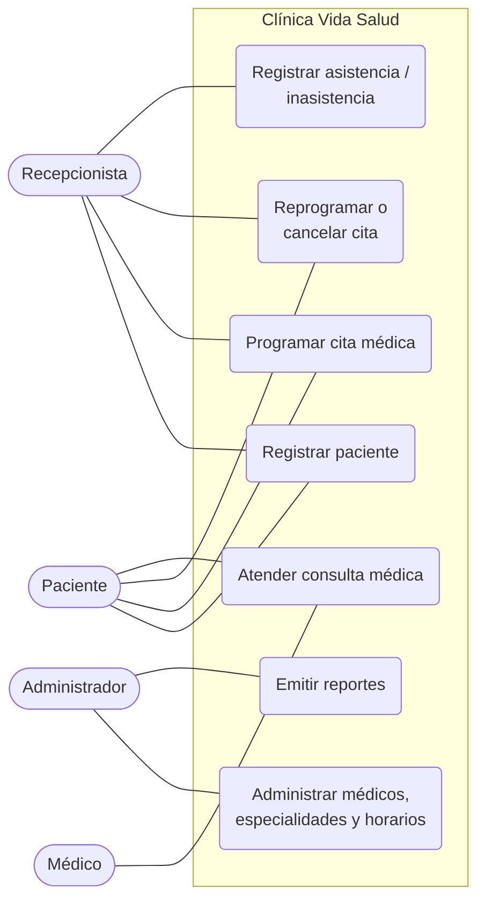

### 3.4 Diagrama de actividades / procesos del negocio

Proceso: **Programar cita médica** (CUN-03).

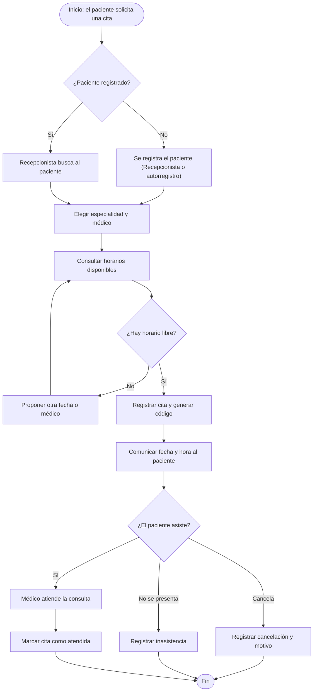

### 3.5 Reglas del negocio

Se aplican independientemente de lo que el usuario escriba en los formularios.

| Código | Regla |
|---|---|
| RN01 | Cada paciente tendrá un identificador único. |
| RN02 | Cada médico tendrá un identificador único. |
| RN03 | Una cita deberá estar asociada a un paciente y a un médico válidos. |
| RN04 | El médico deberá estar activo para recibir nuevas citas. |
| RN05 | La cita deberá pertenecer al horario de atención del médico. |
| RN06 | No se podrán registrar citas en fechas pasadas. |
| RN07 | Un médico no podrá tener citas superpuestas. |
| RN08 | La duración de la cita deberá respetar la configuración del sistema. |
| RN09 | Las citas canceladas no ocuparán disponibilidad. |
| RN10 | Las citas atendidas conservarán su registro histórico. |
| RN11 | No se eliminarán pacientes o médicos con citas históricas asociadas; se desactivarán. |
| RN12 | Solo los usuarios autorizados podrán realizar cada operación. |
| RN13 | La programación y reprogramación verificarán la disponibilidad en el servidor. |
| RN14 | Los datos se almacenarán de forma persistente en PostgreSQL. |
| RN15 | El Paciente solo podrá cancelar o reprogramar una cita con al menos 24 horas de anticipación; la Recepcionista no tiene esta restricción (Ciclo #2). |
| RN16 | Un médico no puede atenderse a sí mismo: la persona del médico y la del paciente de una cita deben ser distintas (Ciclo #2). |

---

## 4. FT. Captura de requisitos

### 4.1 Requisitos funcionales

RF01 a RF13 provienen del enunciado. **RF14 a RF16 son derivados** del punto 3.4 del enunciado (perfil del paciente). Además, RF06, RF08, RF09 y RF12 se extienden para que el Paciente opere sobre **sus propias** citas.

| Código | Requisito | Origen | Ciclo |
|---|---|---|---|
| RF01 | Inicio de sesión y control de acceso por rol | Enunciado | 1 |
| RF02 | Gestión de pacientes (registrar, listar, buscar, modificar, desactivar) | Enunciado | 1 |
| RF03 | Gestión de médicos | Enunciado | 1 |
| RF04 | Gestión de especialidades médicas | Enunciado | 1 |
| RF05 | Gestión de horarios de atención (la duración de la cita se define por especialidad) | Enunciado | 1 |
| RF14 | Cuenta y perfil del paciente: registro propio o alta por la Recepcionista (contraseña temporal), verificación de la ficha, y consulta de su información médica y contacto de emergencia (solo lectura) | Derivado de 3.4 | 1 |
| RF06 | Registro de citas médicas (Recepcionista o Paciente) | Enunciado + 3.4 | 2 |
| RF07 | Prevención de citas duplicadas | Enunciado | 2 |
| RF08 | Reprogramación de citas | Enunciado + 3.4 | 2 |
| RF09 | Cancelación de citas | Enunciado + 3.4 | 2 |
| RF10 | Control de asistencia y estados de la cita | Enunciado | 2 |
| RF11 | Consulta de agenda médica | Enunciado | 2 |
| RF12 | Historial de citas por paciente | Enunciado + 3.4 | 2 |
| RF13 | Reportes | Enunciado | 2 |
| RF15 | Recordatorios de próximas consultas (aviso dentro del sistema) | Derivado de 3.4 | 2 |
| RF16 | Historial médico: notas clínicas por cita atendida | Derivado de 3.4 | 2 |

**Decisiones de alcance** (tomadas para este proyecto, donde el enunciado no es explícito):

- **Identificador de acceso:** el Paciente inicia sesión con su **CI**; el personal (Administrador, Recepcionista, Médico) con su correo. El correo del Paciente es opcional.
- **Modelo de identidad:** una entidad `Persona` guarda los datos comunes (CI, primer nombre, segundo nombre, apellido paterno, apellido materno, fecha de nacimiento, sexo, teléfono, correo, dirección), más un nombre completo que la base calcula a partir de las partes. De ella cuelgan `Paciente` (ficha clínica y verificación), `Medico` (registro profesional) y `Usuario` (credenciales y rol). Una persona puede ser paciente y médico a la vez, pero su cuenta tiene un solo rol (Médico); como paciente la atiende la Recepcionista. El personal administrativo es una persona con cuenta y sin ficha. El CI es único en `Persona`.
- **Duración de la cita:** es un parámetro de la **especialidad** (en minutos), no del horario ni del médico. La cita hereda la duración de la especialidad elegida al reservar. Como la agenda de un médico puede mezclar duraciones, el anti-duplicados compara **intervalos**, no solo la hora de inicio (RF07, RNF17).
- **Códigos:** el «código» de paciente, médico y cita que piden RF02, RF03 y RF06 es su identificador único (`id`). En pantallas e impresos se muestra con formato (`PAC-000001`, `MED-000001`, `CM-000001`), que arma la aplicación a partir del `id`; no se guarda ni se escribe a mano.
- **Registro propio del Paciente:** primer nombre, apellido paterno, CI, celular y contraseña obligatorios; segundo nombre, apellido materno y correo opcionales. Se crea la cuenta y la ficha del paciente en estado **pendiente de verificación**. Si el CI ya tiene ficha, el registro propio se rechaza y se indica pedir el acceso en recepción.
- **Alta de cuenta por la Recepcionista:** para reducir la fricción, la Recepcionista también puede crear la cuenta del Paciente. El sistema genera una **contraseña temporal** aleatoria con vigencia de **72 horas**, la muestra **una sola vez** en pantalla (botones Copiar e Imprimir) y la Recepcionista se la entrega impresa o por mensaje de texto o WhatsApp. El sistema no envía correos ni mensajes. En su primer ingreso el Paciente debe cambiarla; si venció, no puede entrar hasta que se renueve.
- **Renovación y contraseña olvidada:** la Recepcionista o el Administrador pueden generar una nueva contraseña temporal en cualquier momento (porque venció o porque el titular olvidó la suya): se genera otra con nuevas 72 horas y la anterior deja de servir. El titular la solicita a recepción; la pantalla de inicio de sesión muestra el celular de la clínica para ese fin. Para evitar suplantaciones, la contraseña nueva se envía solo al celular registrado en la ficha del paciente (mensaje o WhatsApp) o se entrega en persona con documento, nunca a un número nuevo que indique quien llama. Es el caso de uso **CU-19**: la renovación exige indicar cómo se verificó la identidad y eso queda en la bitácora. La recuperación por cuenta propia del paciente (por correo) queda fuera del alcance: necesita un servicio de correo y el correo del paciente es opcional y no está verificado.
- **Verificación de la ficha:** una ficha de registro propio queda pendiente hasta que la Recepcionista compare el documento en persona y la marque como verificada; en ese acto puede renovar la contraseña, para sacar de la cuenta a quien se haya registrado con un CI ajeno. Mientras está pendiente, el Paciente puede iniciar sesión, ver su perfil básico y reservar citas, pero **no ve su información médica ni sus notas clínicas**. Una ficha creada por la Recepcionista queda verificada de inmediato.
- **Información médica y contacto de emergencia:** los registra y edita la Recepcionista. El Paciente los ve en solo lectura. El Médico los ve en solo lectura.
- **Edición del Paciente:** solo teléfono y contraseña. No edita nombre (identidad) ni correo (usuario de acceso).
- **RF15 Recordatorios:** aviso dentro del sistema, sin correo. Al iniciar sesión, el Paciente ve un banner con sus próximas citas (los siguientes 2 días).
- **RF16 Historial médico:** el Médico registra una nota clínica por cada cita atendida con motivo de consulta, diagnóstico, tratamiento o indicaciones, y observaciones. Cada Médico edita solo sus propias notas; al editarla se sobrescribe y se guarda quién y cuándo la modificó por última vez, sin conservar versiones. Ven las notas: el Médico, el Paciente y la Recepcionista, todas en solo lectura salvo el autor.
- **Acceso del Médico:** solo a los pacientes que tienen o tuvieron cita con él; ve sus datos básicos, información médica, contacto de emergencia y las notas clínicas, incluidas las de otros médicos.
- **Modalidad:** la cita tiene un campo `modalidad` (presencial o virtual).
- **Sucursal:** la base de datos incluye la tabla `sucursales` con una sola sucursal cargada y `sucursal_id` en horarios de atención y citas, para poder escalar. No hay pantalla de gestión de sucursales. El `consultorio` se registra en el horario de atención. No hay filtro por ubicación.

**Opcionales abiertos** (el enunciado los marca como opcionales; se implementan solo si el tiempo del Ciclo #2 lo permite):

- Feriados y bloqueos de agenda para excluir fechas de la disponibilidad (RF05).
- Exportación de reportes a CSV o PDF (RF13).

**Fuera del alcance** (descartado a propósito):

- Lista de espera.
- Recordatorios por SMS o correo (el aviso es solo dentro del sistema).
- Seguros médicos, pagos y verificación en dos pasos.

La lista de espera y los recordatorios por SMS o correo se mencionan como mejoras futuras en las conclusiones.

### 4.2 Requisitos no funcionales

| Código | Categoría | Requisito |
|---|---|---|
| RNF01 | Tecnología | Backend en PHP con el framework Laravel, base de datos PostgreSQL y acceso a datos sobre PDO (`pdo_pgsql`). |
| RNF02 | Tecnología | Interfaz con HTML5 y CSS3 generados en el servidor mediante plantillas Blade de Laravel; JavaScript para validaciones e interacción. |
| RNF03 | Despliegue | Ejecución en servidor local Apache (XAMPP o entorno PHP equivalente), con el directorio `public/` de Laravel como raíz web. |
| RNF04 | Seguridad | Contraseñas almacenadas con un hash seguro (`password_hash()` de PHP, que usa internamente el hasher de Laravel) y verificadas con `password_verify()` o su equivalente. |
| RNF05 | Seguridad | Consultas SQL parametrizadas para evitar inyección SQL. |
| RNF06 | Seguridad | Uso de sesiones; las páginas internas rechazan el acceso sin sesión válida. |
| RNF07 | Seguridad | Los errores no muestran credenciales ni detalles internos al usuario. |
| RNF08 | Integridad | Validación de datos en cliente y en servidor. |
| RNF09 | Datos | Base de datos normalizada, sin duplicación innecesaria. |
| RNF10 | Mantenibilidad | Separación razonable entre interfaz, lógica de negocio y acceso a datos. |
| RNF11 | Mantenibilidad | Código comentado, con buenas prácticas, publicado en GitHub. |
| RNF12 | Usabilidad | Diseño profesional y mensajes de error comprensibles. |
| RNF13 | Seguridad | Bitácora de auditoría: se registra usuario, acción, entidad afectada y fecha al iniciar sesión y al crear o modificar usuarios, pacientes, información médica y notas clínicas, y al crear o renovar cuentas y verificar fichas. Solo escrituras, sin registrar lecturas. |
| RNF14 | Seguridad | Cierre automático de la sesión tras 30 minutos de inactividad. |
| RNF15 | Seguridad | Bloqueo de la cuenta durante 15 minutos tras 5 intentos fallidos seguidos de inicio de sesión, y token CSRF en los formularios que modifican datos. |
| RNF16 | Privacidad | Los avisos y recordatorios muestran solo fecha, hora y médico, nunca motivo, diagnóstico ni datos médicos. |
| RNF17 | Integridad | Además de la validación en PHP, la base de datos impide por restricción citas superpuestas del mismo médico (Ciclo #2). |
| RNF18 | Seguridad | Las contraseñas temporales se generan de forma aleatoria con un generador criptográfico, vencen a las 72 horas, se muestran una sola vez, se guardan solo como hash y obligan a cambiarlas en el primer ingreso. |
| RNF19 | Seguridad | Control de acceso por permisos (RBAC): cada operación exige un permiso `recurso:accion` concedido por el rol de la cuenta. La interfaz oculta lo no permitido y el servidor lo verifica en cada solicitud (RN12). |
| RNF20 | Seguridad | El registro propio del paciente es público, así que se limita a 10 solicitudes por minuto por dirección IP, y una contraseña escrita nunca se vuelve a mostrar en el formulario. |

### 4.3 Actores del sistema

| Actor | Descripción | Origen |
|---|---|---|
| **Administrador** | Configura y supervisa el sistema: usuarios, roles, médicos, especialidades, horarios y reportes; renueva contraseñas temporales. | Enunciado 3.1 |
| **Recepcionista** | Gestiona pacientes (incluida su información médica y contacto de emergencia), crea cuentas de paciente con contraseña temporal, verifica fichas, renueva contraseñas temporales, gestiona citas y registra asistencia. | Enunciado 3.2 |
| **Médico** | Consulta su agenda, marca citas atendidas y registra sus notas clínicas. | Enunciado 3.3 |
| **Paciente** | Tiene cuenta propia y entra con su CI; ve su perfil e información médica en solo lectura (una vez verificada su ficha), edita su teléfono y contraseña, y gestiona sus propias citas. | Enunciado 3.4 |

### 4.4 Diagrama de casos de uso

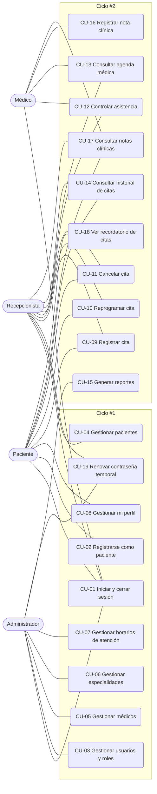

### 4.5 Priorización y selección de casos de uso por ciclo

| Caso de uso | RF | Prioridad | Ciclo | Justificación |
|---|---|---|---|---|
| CU-01 Iniciar y cerrar sesión | RF01 | Alta | 1 | Base de seguridad; todo lo demás depende de él. |
| CU-02 Registrarse como paciente | RF14 | Alta | 1 | Permite que el Paciente tenga cuenta. |
| CU-03 Gestionar usuarios y roles | RF01 | Alta | 1 | Habilita al personal y sus permisos. |
| CU-04 Gestionar pacientes | RF02, RF14 | Alta | 1 | Dato maestro requerido por las citas; incluye información médica, contacto de emergencia, creación de cuenta y verificación de la ficha. |
| CU-05 Gestionar médicos | RF03 | Alta | 1 | Dato maestro requerido por las citas. |
| CU-06 Gestionar especialidades | RF04 | Alta | 1 | Dato maestro requerido por médicos. |
| CU-07 Gestionar horarios de atención | RF05 | Alta | 1 | Define la disponibilidad que usa el Ciclo #2. |
| CU-08 Gestionar mi perfil | RF14 | Media | 1 | Consulta en solo lectura y edición de teléfono y contraseña. |
| CU-09 Registrar cita | RF06, RF07 | Alta | 2 | Núcleo del sistema; depende de CU-04 a CU-07. |
| CU-10 Reprogramar cita | RF08 | Alta | 2 | Depende de CU-09. |
| CU-11 Cancelar cita | RF09 | Alta | 2 | Depende de CU-09. |
| CU-12 Controlar asistencia | RF10 | Alta | 2 | Depende de CU-09. |
| CU-13 Consultar agenda médica | RF11 | Media | 2 | Depende de CU-09. |
| CU-14 Consultar historial de citas | RF12 | Media | 2 | Depende de CU-09. |
| CU-15 Generar reportes | RF13 | Media | 2 | Requiere citas ya registradas. |
| CU-16 Registrar nota clínica | RF16 | Media | 2 | Requiere citas atendidas (CU-12). |
| CU-17 Consultar notas clínicas | RF16 | Media | 2 | Depende de CU-16. |
| CU-18 Ver recordatorio de citas | RF15 | Baja | 2 | Banner al iniciar sesión; depende de CU-09. |
| CU-19 Renovar contraseña temporal | RF01, RF14 | Alta | 1 | Recupera el acceso sin servidor de correo; es la vía de quien olvidó su contraseña. |

**Criterio:** el Ciclo #1 entrega la base (acceso y datos maestros) y el Ciclo #2 el núcleo de citas, que necesita esa base estable.

### 4.6 Especificación de casos de uso

Se especifican los casos de uso del Ciclo #1. Los del Ciclo #2 se agregan en la segunda presentación.

#### CU-01 Iniciar y cerrar sesión

| | |
|---|---|
| **Actores** | Administrador, Recepcionista, Médico, Paciente |
| **Requisito** | RF01 |
| **Precondición** | El usuario tiene una cuenta activa. |
| **Postcondición** | Existe una sesión válida con el rol del usuario, o la sesión queda cerrada. |

**Flujo principal**
1. El usuario ingresa su identificador (el Paciente su CI; el personal su correo) y su contraseña.
2. El sistema valida los datos en el servidor y verifica la contraseña con `password_verify()`.
3. El sistema inicia la sesión e identifica el rol de la cuenta y sus permisos.
4. El sistema muestra el menú según los permisos del rol.
5. El usuario cierra la sesión y el sistema la destruye.

**Flujos alternos**
- 2a. Credenciales incorrectas: se muestra un mensaje genérico y no se inicia sesión.
- 2b. Cuenta inactiva: se rechaza el acceso.
- 2c. Contraseña temporal vigente: tras validar, el sistema obliga a cambiarla antes de continuar.
- 2d. Contraseña temporal vencida: se rechaza el acceso y se indica pedir su renovación a recepción.
- 2e. El usuario olvidó su contraseña: la pantalla de inicio de sesión muestra el celular de la clínica para pedir a recepción una contraseña temporal nueva.
- 2f. Cuenta bloqueada: tras 5 intentos fallidos seguidos se bloquea durante 15 minutos y se informa el tiempo de espera.
- *. Inactividad: tras 30 minutos sin actividad la sesión se cierra.
- *. Cuenta desactivada con la sesión abierta: en la solicitud siguiente se cierra la sesión, porque se comprueba el estado de la cuenta en cada solicitud.
- *. Acceso a una página interna sin sesión válida: se redirige al inicio de sesión.

#### CU-02 Registrarse como paciente

| | |
|---|---|
| **Actores** | Paciente |
| **Requisito** | RF14, RF02 |
| **Precondición** | El visitante no tiene cuenta. |
| **Postcondición** | Queda creada la cuenta con rol Paciente y su ficha en estado pendiente de verificación. La Recepcionista la verifica con el documento (CU-04). |

**Flujo principal**
1. El visitante completa el formulario (primer nombre, apellido paterno, CI, celular, contraseña; segundo nombre, apellido materno y correo opcionales).
2. El sistema valida los datos en cliente y servidor (incluido el formato del celular).
3. El sistema verifica que el CI no esté registrado como persona y que el correo, si se ingresó, no esté registrado.
4. El sistema guarda la contraseña con `password_hash()` y crea la ficha del paciente en estado pendiente de verificación junto con su cuenta.
5. El sistema confirma el registro.

**Flujos alternos**
- 3a. El CI ya está registrado: se rechaza el registro y se indica pedir el acceso en recepción.
- 3b. Correo ya registrado: se rechaza el registro con un mensaje.
- 3c. Dos registros simultáneos con el mismo CI o correo: el segundo se rechaza con el mismo mensaje y no deja datos a medias (el alta es una sola transacción).
- 2a. Datos inválidos: se indican los campos a corregir.

#### CU-03 Gestionar usuarios y roles

| | |
|---|---|
| **Actores** | Administrador |
| **Requisito** | RF01 |
| **Precondición** | El Administrador inició sesión. |
| **Postcondición** | El usuario queda creado, modificado, con rol asignado o activado/desactivado. |

**Flujo principal**
1. El Administrador abre la lista de usuarios del personal (las cuentas de pacientes se gestionan en CU-02 y CU-04).
2. Elige crear o modificar un usuario e ingresa los datos de la persona (CI, primer nombre, segundo nombre opcional, apellido paterno, apellido materno opcional, teléfono, correo) y el rol. Si el rol es Médico, selecciona el médico (CU-05) al que se vincula la cuenta.
3. El sistema valida los datos y que el CI y el correo sean únicos.
4. El sistema guarda el cambio. Al crear un usuario, genera una contraseña temporal aleatoria con vigencia de 72 horas y la muestra una sola vez, con botones Copiar e Imprimir; el Administrador se la entrega al empleado, quien debe cambiarla en su primer ingreso.
5. El Administrador puede activar o desactivar la cuenta.
6. Si el titular olvidó su contraseña o la temporal venció, el Administrador puede renovarla en cualquier momento: el sistema genera otra con nuevas 72 horas, la muestra una sola vez e invalida la anterior.

**Flujos alternos**
- 3a. CI o correo repetido: se rechaza el cambio.
- 3b. El médico seleccionado ya tiene una cuenta vinculada: se rechaza el cambio.

#### CU-04 Gestionar pacientes

| | |
|---|---|
| **Actores** | Recepcionista |
| **Requisito** | RF02, RF14 |
| **Precondición** | La Recepcionista inició sesión. |
| **Postcondición** | El paciente queda registrado, modificado, verificado, con su cuenta creada o renovada, o desactivado sin perder su historial. |

**Flujo principal**
1. La Recepcionista busca por CI, nombre o apellido, o abre el formulario de alta.
2. Registra o modifica los datos personales (CI, primer nombre, segundo nombre, apellido paterno, apellido materno, fecha de nacimiento, sexo, teléfono, correo, dirección), la información médica (tipo de sangre, alergias, enfermedades crónicas, medicamentos, antecedentes relevantes) y el contacto de emergencia (nombre, parentesco, teléfono).
3. El sistema valida los datos. Si el CI ya existe como persona sin ficha de paciente (por ejemplo, un médico), reutiliza esa persona y le crea la ficha.
4. El sistema guarda los cambios.
5. Si el paciente no tiene cuenta, la Recepcionista la crea: el sistema genera una contraseña temporal aleatoria con vigencia de 72 horas y la muestra una sola vez, con botones Copiar e Imprimir. La Recepcionista se la entrega al paciente, impresa o por mensaje de texto o WhatsApp. El paciente entra con su CI.
6. Si el paciente se registró solo (CU-02), la Recepcionista compara su documento y marca la ficha como verificada; en ese acto puede renovar la contraseña.
7. Si el paciente olvidó su contraseña o la temporal venció, la Recepcionista puede renovarla en cualquier momento: el sistema genera otra con nuevas 72 horas e invalida la anterior.
8. Para dar de baja, la Recepcionista desactiva el registro; no se elimina. Si el paciente tiene cuenta de paciente, esta se desactiva con él y se reactiva si lo reactiva.

**Flujos alternos**
- 3a. El CI ya tiene ficha de paciente: se rechaza el registro (RN01).
- 5a. El paciente ya tiene cuenta: no se crea otra.
- 5b. El paciente está desactivado: no se crea ni se renueva su acceso.
- 5c. La persona ya tiene una cuenta con otro rol (por ejemplo, Médico): no se crea una cuenta de paciente; como paciente la atiende la recepción, y su contraseña la renueva el Administrador (CU-03).
- 6a. El documento no coincide con la ficha: la ficha sigue pendiente de verificación.
- 8a. Paciente con citas históricas: solo se permite desactivar (RN11).
- *. Una ficha creada por la Recepcionista queda verificada de inmediato.

#### CU-05 Gestionar médicos

| | |
|---|---|
| **Actores** | Administrador |
| **Requisito** | RF03 |
| **Precondición** | El Administrador inició sesión y existen especialidades. |
| **Postcondición** | El médico queda registrado, modificado o activado/desactivado. |

**Flujo principal**
1. El Administrador abre el listado de médicos (con búsqueda por nombre o especialidad).
2. Registra o modifica los datos de la persona (CI, primer nombre, segundo nombre, apellido paterno, apellido materno, teléfono, correo), el registro profesional y las especialidades. Si el CI ya existe como persona, reutiliza esa persona.
3. El sistema valida los datos y la unicidad del código y del registro profesional.
4. El sistema guarda los cambios.
5. El Administrador activa o desactiva al médico.

**Flujos alternos**
- 3a. Código o registro profesional repetido: se rechaza.
- 5a. Un médico inactivo no recibe nuevas citas, pero conserva las históricas (RN04, RN11).

#### CU-06 Gestionar especialidades

| | |
|---|---|
| **Actores** | Administrador |
| **Requisito** | RF04 |
| **Precondición** | El Administrador inició sesión. |
| **Postcondición** | La especialidad queda registrada, modificada o activada/desactivada. |

**Flujo principal**
1. El Administrador abre el listado de especialidades.
2. Registra o modifica nombre, descripción (opcional), duración de la cita en minutos (por ejemplo, 30) y estado.
3. El sistema valida y comprueba que el nombre normalizado no exista.
4. El sistema guarda los cambios.

**Flujos alternos**
- 3a. Nombre repetido: se rechaza el registro.

#### CU-07 Gestionar horarios de atención

| | |
|---|---|
| **Actores** | Administrador |
| **Requisito** | RF05 |
| **Precondición** | El Administrador inició sesión y el médico existe y está activo. |
| **Postcondición** | El horario del médico queda registrado o modificado; el sistema puede calcular los bloques disponibles. |

**Flujo principal**
1. El Administrador selecciona un médico.
2. Registra día, hora inicial, hora final y consultorio. La duración de la cita no se define aquí: la determina la especialidad con la que se reserva (CU-06). La sucursal es la única registrada, por lo que se asigna automáticamente.
3. El sistema valida que la hora final sea posterior a la inicial y que no se superponga con otro horario del médico.
4. El sistema guarda el horario.

**Flujos alternos**
- 3a. Horario inválido o superpuesto: se rechaza con un mensaje.

#### CU-08 Gestionar mi perfil

| | |
|---|---|
| **Actores** | Paciente |
| **Requisito** | RF14 |
| **Precondición** | El Paciente inició sesión. |
| **Postcondición** | El teléfono y/o la contraseña del Paciente quedan actualizados. |

**Flujo principal**
1. El Paciente abre su perfil, donde ve sus datos personales y, si su ficha está verificada, su información médica y su contacto de emergencia en solo lectura.
2. Modifica su teléfono o su contraseña.
3. El sistema valida los datos en cliente y servidor.
4. El sistema guarda los cambios.

**Flujos alternos**
- 3a. Datos inválidos: se indican los campos a corregir.
- El Paciente no puede modificar su nombre, CI, correo, información médica ni contacto de emergencia; esos cambios los realiza la Recepcionista.

#### CU-19 Renovar contraseña temporal

| | |
|---|---|
| **Actores** | Recepcionista (cuentas de pacientes) y Administrador (cuentas del personal, desde CU-03). El titular de la cuenta participa pidiendo la renovación. |
| **Requisito** | RF01, RF14 |
| **Precondición** | La cuenta existe y está activa. El titular pidió una contraseña nueva porque olvidó la suya o la temporal venció. |
| **Postcondición** | La cuenta tiene una contraseña temporal nueva de 72 horas, la anterior no sirve, se levantó el bloqueo y quedó en la bitácora quién la renovó y cómo se verificó la identidad. |

**Flujo principal**
1. El titular pide una contraseña nueva a recepción (la pantalla de inicio de sesión muestra el celular de la clínica) o, si es del personal, al Administrador.
2. La Recepcionista **comprueba la identidad** del titular: compara su documento de identidad en persona, o responde solo al celular registrado en su ficha.
3. Abre la ficha del paciente (CU-04), elige «Renovar contraseña temporal» e indica cómo verificó la identidad.
4. El sistema genera una contraseña temporal aleatoria de 14 caracteres con vigencia de 72 horas, invalida la anterior, pone en cero los intentos fallidos y levanta el bloqueo.
5. El sistema muestra la contraseña **una sola vez** (botones Copiar e Imprimir) y registra en la bitácora quién renovó, a quién y cómo se verificó la identidad.
6. La Recepcionista entrega la contraseña impresa, en persona, o por mensaje al celular registrado.
7. El titular entra (CU-01) y el sistema le obliga a elegir una contraseña propia.

**Flujos alternos**
- 2a. No se puede comprobar la identidad: no se renueva ni se entrega nada.
- 2b. Quien llama pide que se envíe a un número distinto del registrado: no se envía; debe presentarse con su documento.
- 3a. El sistema exige indicar cómo se verificó la identidad: sin esa indicación no se renueva.
- 3b. El paciente está desactivado: no se renueva; primero se reactiva (CU-04).
- 3c. La persona tiene una cuenta con otro rol (por ejemplo, Médico): la recepcionista no la renueva; lo hace el Administrador.
- 3d. El paciente no tiene cuenta: se crea su acceso (CU-04, paso 5) en lugar de renovar.
- 7a. La contraseña temporal vence sin usarse (72 horas): se vuelve a renovar.
- *. Un Administrador olvida su contraseña: otro Administrador se la renueva. Si no hay otro, el administrador del servidor ejecuta en la consola `php artisan administrador:renovar-password {correo}`, que solo sirve para cuentas de Administrador y deja constancia en la bitácora, sin usuario actor.

**Fuera del alcance:** la recuperación por cuenta propia del paciente mediante un enlace enviado por correo.

### 4.7 Control de acceso (RBAC)

Cada operación exige un permiso con formato `recurso:accion`. Los permisos se agrupan en roles y cada cuenta tiene un único rol. El catálogo es fijo en este proyecto: el Administrador asigna el rol de una cuenta (CU-03), pero no edita qué permisos concede cada rol.

| Permiso | Administrador | Recepcionista | Médico | Paciente |
|---|:-:|:-:|:-:|:-:|
| `usuarios:gestionar` | ✓ | | | |
| `accesos:renovar` | ✓ | ✓ | | |
| `pacientes:gestionar` | | ✓ | | |
| `pacientes:consultar` | | ✓ | ✓ | |
| `pacientes:verificar` | | ✓ | | |
| `pacientes:crear_acceso` | | ✓ | | |
| `medicos:gestionar` | ✓ | | | |
| `especialidades:gestionar` | ✓ | | | |
| `horarios:gestionar` | ✓ | | | |
| `perfil:gestionar` | | | | ✓ |
| `citas:gestionar` | | ✓ | | |
| `citas:gestionar_propias` | | | | ✓ |
| `citas:atender` | | | ✓ | |
| `agenda:consultar` | | ✓ | ✓ | |
| `historial:consultar` | | ✓ | | ✓ |
| `notas:registrar` | | | ✓ | |
| `notas:consultar` | | ✓ | ✓ | ✓ |
| `recordatorios:consultar` | | | | ✓ |
| `reportes:consultar` | ✓ | | | |
| **Total** | 6 | 9 | 5 | 5 |

**Alcance dentro del permiso.** El permiso dice qué acción se puede hacer, no sobre qué datos. La aplicación acota el alcance: el Paciente solo ve lo propio (`citas:gestionar_propias`, `historial:consultar`, `notas:consultar`), y solo con la ficha verificada; el Médico solo ve a los pacientes que tienen o tuvieron cita con él y edita solo sus notas.

**Aplicación en Laravel.** Cada permiso se declara como *Gate*; las rutas lo exigen con el middleware `can:` y las vistas ocultan lo no permitido (RNF19).

**Por qué normalizado.** Los permisos son filas validadas por claves foráneas, no un arreglo de texto: un permiso mal escrito se rechaza al cargarlo. Es una mejora sobre el modelo de Portal Watts, donde los permisos son un `text[]` sin validar.

---

## 5. FT. Análisis

### 5.1 Diagrama de clases de análisis

Modelo del sistema completo (Ciclos #1 y #2), porque el diseño de datos del Ciclo #1 ya necesita las clases de citas y notas clínicas.

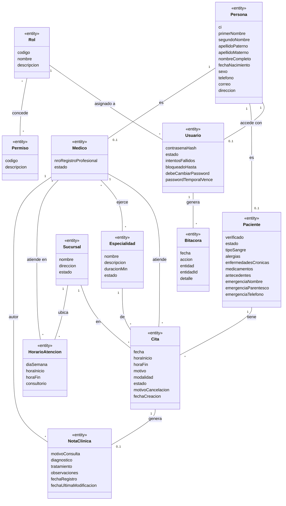

**Clases de interfaz y de control del Ciclo #1** (cada caso de uso tiene su `«boundary»` y su `«control»`; las `«entity»` son las del diagrama):

| Caso de uso | «boundary» | «control» | «entity» |
|---|---|---|---|
| CU-01 Iniciar y cerrar sesión | FormLogin, MenuPrincipal | ControlAcceso | Persona, Usuario, Rol, Permiso, Bitacora |
| CU-02 Registrarse como paciente | FormRegistro | ControlRegistro | Persona, Paciente, Usuario |
| CU-03 Gestionar usuarios y roles | ListaUsuarios, FormUsuario | ControlUsuario | Persona, Usuario, Rol, Medico, Bitacora |
| CU-04 Gestionar pacientes | ListaPacientes, FormPaciente | ControlPaciente | Persona, Paciente, Usuario, Bitacora |
| CU-05 Gestionar médicos | ListaMedicos, FormMedico | ControlMedico | Persona, Medico, Especialidad |
| CU-06 Gestionar especialidades | ListaEspecialidades, FormEspecialidad | ControlEspecialidad | Especialidad |
| CU-07 Gestionar horarios de atención | ListaHorarios, FormHorario | ControlHorario | HorarioAtencion, Medico, Sucursal |
| CU-08 Gestionar mi perfil | VistaPerfil | ControlPerfil | Persona, Paciente, Usuario |
| CU-19 Renovar contraseña temporal | FichaPaciente, ComprobanteCredenciales | ControlAccesoPaciente | Persona, Paciente, Usuario, Bitacora |

### 5.2 Diagramas de comunicación / colaboración

Se presentan CU-01, CU-02 y CU-04 del Ciclo #1. Los números en las flechas indican el orden de los mensajes. Los demás casos se agregan en la segunda presentación.

**CU-01 Iniciar y cerrar sesión**

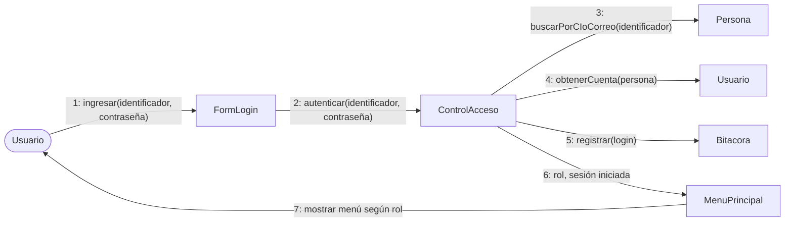

**CU-02 Registrarse como paciente**

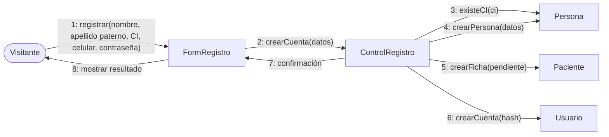

**CU-04 Gestionar pacientes**

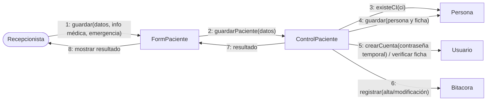

### 5.3 Diagrama de estados de la cita

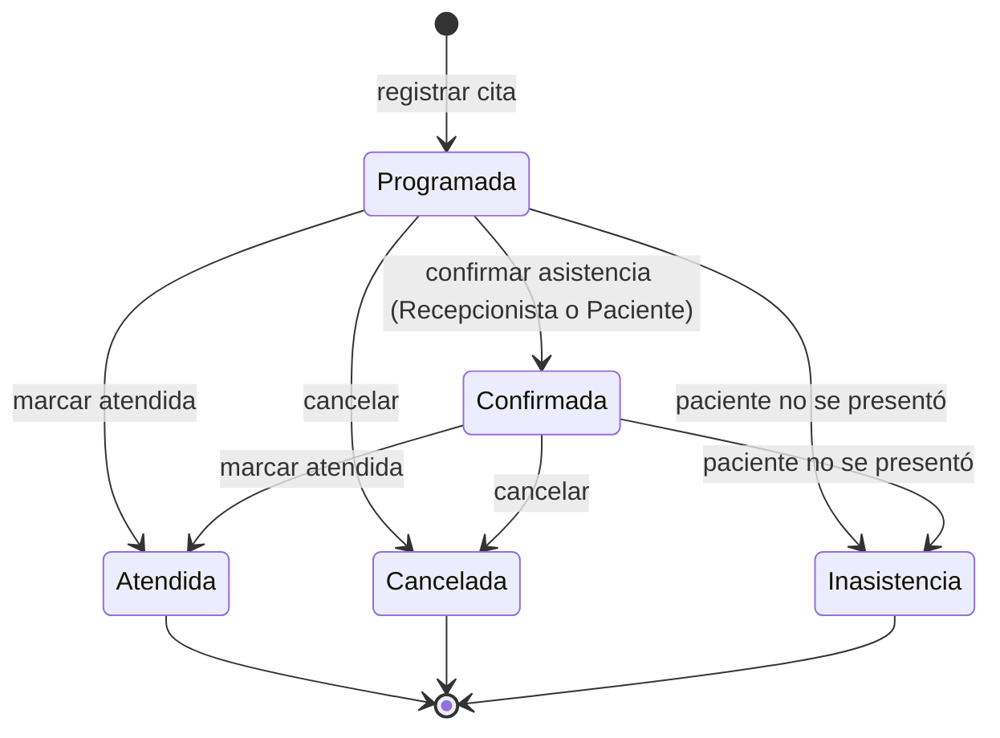

| Estado | Ocupa horario | Reprogramable | Cancelable |
|---|---|---|---|
| Programada | Sí | Sí | Sí |
| Confirmada | Sí | Sí | Sí |
| Atendida | Sí (histórico) | No | No |
| Cancelada | No (RN09) | No | No |
| Inasistencia | Sí (histórico) | No | No |

Una cita cancelada no puede marcarse como atendida sin un procedimiento autorizado (RF10); ese procedimiento queda por definir en el Ciclo #2.

---

## 6. FT. Diseño

### 6.1 Diseño de arquitectura

#### 6.1.1 Arquitectura lógica

Arquitectura en capas sobre el patrón MVC de Laravel. Cada estereotipo del análisis (sección 5) se materializa en un artefacto concreto.

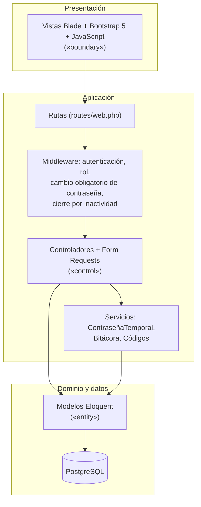

| Estereotipo del análisis | Artefacto en Laravel | Ubicación |
|---|---|---|
| «boundary» (FormLogin, ListaPacientes...) | Vistas Blade | `resources/views/` |
| «control» (ControlAcceso, ControlPaciente...) | Controladores y Form Requests (validación) | `app/Http/Controllers/`, `app/Http/Requests/` |
| «entity» (Persona, Usuario, Paciente...) | Modelos Eloquent | `app/Models/` |
| Reglas transversales (contraseña temporal, bitácora, códigos) | Servicios | `app/Services/` |
| Control de acceso (RNF06, RNF14, RNF15) | Middleware | `app/Http/Middleware/` |

**Reglas de la arquitectura**
- Las vistas no contienen lógica de negocio ni consultas.
- Los controladores no escriben SQL: usan los modelos y los servicios.
- Toda validación se hace en el servidor (Form Requests) y se refuerza en el cliente con JavaScript (RNF08).
- Las consultas pasan por Eloquent o por el constructor de consultas de Laravel, que usan sentencias parametrizadas (RNF05).

#### 6.1.2 Arquitectura física (despliegue)

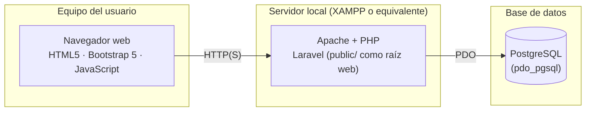

| Nodo | Software | Responsabilidad |
|---|---|---|
| Cliente | Navegador moderno | Muestra la interfaz y ejecuta las validaciones de JavaScript. |
| Servidor de aplicación | Apache, PHP y Laravel | Procesa las solicitudes, aplica las reglas de negocio y mantiene las sesiones. |
| Servidor de datos | PostgreSQL | Almacena los datos de forma persistente (RN14). |

Los archivos de Bootstrap se sirven desde `public/`, sin depender de una conexión a internet.

### 6.2 Diseño de casos de uso (diagramas de secuencia)

Se diseñan CU-01, CU-02 y CU-04 (creación de cuenta con contraseña temporal). Los demás casos del Ciclo #1 siguen el mismo patrón de controlador, Form Request, servicio y modelo.

**CU-01 Iniciar sesión**

```mermaid
sequenceDiagram
    actor U as Usuario
    participant V as FormLogin (Blade)
    participant C as AccesoController
    participant P as Persona
    participant S as Usuario
    participant B as BitacoraService

    U->>V: ingresa identificador y contraseña
    V->>C: POST /login
    C->>P: buscar por CI o correo
    P-->>C: persona
    C->>S: obtener cuenta
    alt cuenta inactiva o bloqueada
        C-->>V: mensaje genérico o tiempo de espera
    else contraseña incorrecta
        C->>S: sumar intento fallido (bloquear al 5.º)
        C->>B: registrar login fallido
        C-->>V: mensaje genérico
    else contraseña correcta
        alt contraseña temporal vencida
            C-->>V: rechazar y pedir renovación a recepción
        else
            C->>S: reiniciar intentos fallidos
            C->>B: registrar login
            C-->>U: redirigir (cambiar contraseña si es temporal; si no, menú del rol)
        end
    end
```

**CU-02 Registrarse como paciente**

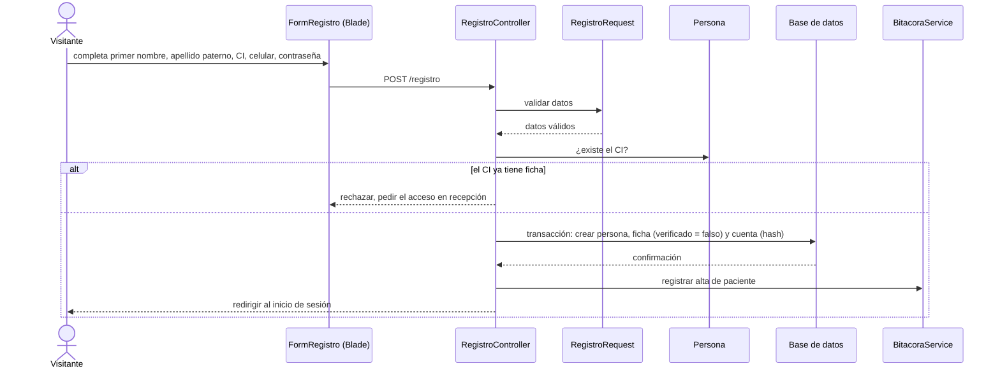

**CU-04 Crear la cuenta de un paciente**

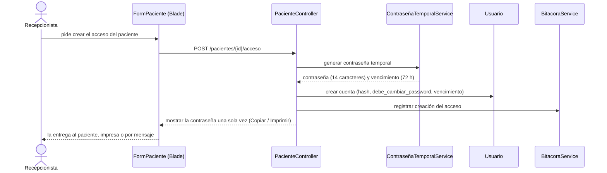

**CU-19 Renovar contraseña temporal**

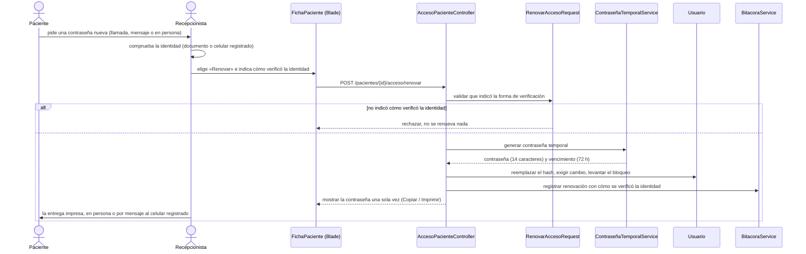

El Administrador renueva las cuentas del personal con el mismo flujo desde CU-03. Si el único Administrador olvida su contraseña, el administrador del servidor usa el comando de consola `php artisan administrador:renovar-password {correo}`, que deja constancia en la bitácora.

### 6.3 Diseño de datos

#### 6.3.1 Modelo lógico

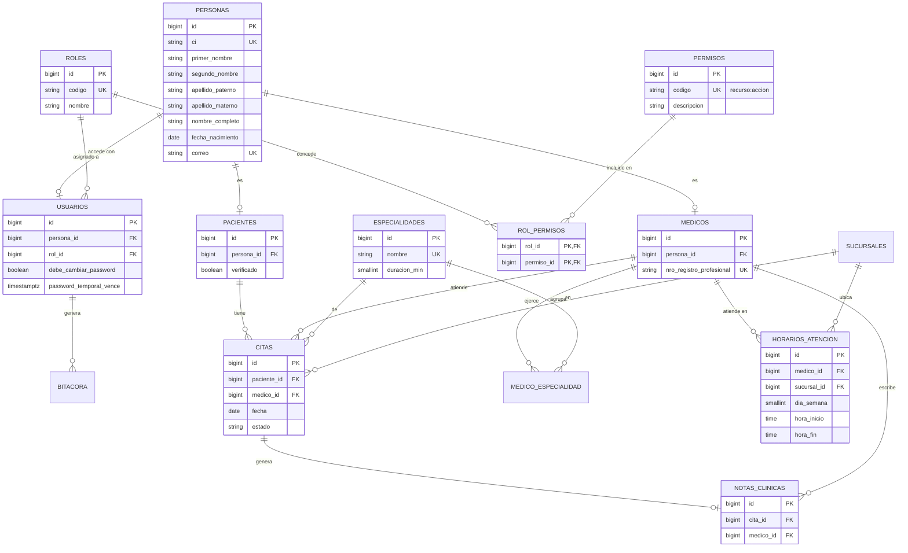

**Decisiones del modelo**
- Todos los textos son de tipo `TEXT`; los formatos que importan (CI, teléfono, correo, tipo de sangre, códigos) se acotan con `CHECK`.
- El nombre de la persona es atómico: `primer_nombre` y `apellido_paterno` obligatorios, `segundo_nombre` y `apellido_materno` opcionales (si se escriben, no pueden estar en blanco). `nombre_completo` es una columna generada que une las partes, así que nunca se desincroniza y sirve para buscar e imprimir.
- En `usuarios`, `debe_cambiar_password` y `password_temporal_vence` van siempre juntas (restricción `CHECK`): una contraseña temporal siempre tiene vencimiento y, al cambiarla, ambas se limpian a la vez. El contador `intentos_fallidos` se pone en cero al entrar bien o al renovar la contraseña.
- Una cuenta se da de baja desactivándola (`estado = false`), no eliminándola: la bitácora y las notas clínicas la referencian con `RESTRICT`, para no perder quién hizo cada cosa. La aplicación no ofrece eliminar cuentas.
- Todos los identificadores son `BIGINT`, para no mezclar tipos en las claves foráneas. `SMALLINT` se reserva para valores acotados por naturaleza: `duracion_min`, `dia_semana` e `intentos_fallidos`.
- El control de acceso es RBAC normalizado: `roles`, `permisos` y `rol_permisos` son tablas, y `usuarios.rol_id` es una clave foránea al rol. Los permisos tienen formato `recurso:accion` (restricción `CHECK`) y se asignan a los roles por claves foráneas, así que la base rechaza un permiso inexistente. Cada cuenta tiene un solo rol: una persona puede ser médico y paciente a la vez, pero su cuenta tiene rol Médico; como paciente la atiende la recepción. Los catálogos iniciales se cargan con `003_catalogos_iniciales.sql`.
- El estado activo/inactivo vive en cada especialización (`pacientes.estado`, `medicos.estado`), no en `personas`: desactivar a un paciente no debe desactivar a la misma persona como médico (RN11).
- `ON DELETE RESTRICT` en las claves hacia pacientes, médicos y citas: nada con historial se elimina, solo se desactiva (RN10, RN11).
- El CI es único en `personas`; el correo es único sin distinguir mayúsculas y solo cuando existe.
- Los datos del personal administrativo (Administrador, Recepcionista) viven en `personas` y `usuarios`, sin ficha.
- El correo es obligatorio para el personal y para el Paciente es opcional; esa regla la valida la aplicación, porque depende del rol.
- Una restricción de exclusión impide horarios de atención superpuestos del mismo médico en el mismo día (CU-07) y citas superpuestas del mismo médico (RNF17); las citas canceladas no cuentan.
- Una clave foránea compuesta exige que el médico de una cita ejerza la especialidad elegida, y otra ata la nota clínica al médico de su cita. Consecuencia: no se puede quitar una especialidad a un médico que tiene citas con ella.
- El código de paciente, médico y cita es el `id`, identificador único (RF02, RF03, RF06); el formato `PAC-000001` se arma al mostrarlo y no se guarda. Pueden quedar saltos en la numeración, porque el `id` no se revierte si el alta falla. La matrícula del médico (`nro_registro_profesional`) es un dato distinto: la emite una entidad externa y se guarda aparte, única y obligatoria.
- La bitácora es de solo escritura: un disparador impide modificar, borrar o vaciar sus filas. Su campo `detalle` guarda el contexto de la acción, por ejemplo cómo se verificó la identidad al renovar una contraseña (CU-19).
- Las claves foráneas llevan índice, porque PostgreSQL no los crea solo.
- Las reglas que cruzan tablas (cita dentro del horario del médico, duración de la cita, médico activo, fecha futura, transiciones de estado, que un médico no se atienda a sí mismo) las valida la aplicación y se cubren con pruebas.

#### 6.3.2 Modelo físico (DDL PostgreSQL)

El script es el contenido de `codigo/database/sql/001_esquema_base.sql` (Ciclo #1) y `002_citas_y_notas.sql` (Ciclo #2), que las migraciones de Laravel ejecutan; `003_catalogos_iniciales.sql` carga los datos de referencia (sucursal, roles y permisos, ver 4.7). Se verificó en PostgreSQL 16: los `CHECK` de formato, la restricción contra horarios y citas superpuestas, las claves foráneas compuestas, el control de acceso y la bitácora de solo escriturarechazan lo inválido, y `migrate:rollback` deja la base limpia. Las tablas propias del framework (`migrations`) no se listan.

```sql
-- Ciclo #1: identidad, acceso, datos maestros y bitácora.
-- Referencia de diseño: documento/Informe-Final.md, sección 6.3.2.
-- Los textos usan TEXT; los formatos se acotan con CHECK donde importa.

CREATE EXTENSION IF NOT EXISTS btree_gist;

CREATE TABLE sucursales (
    id         BIGSERIAL   PRIMARY KEY,
    nombre     TEXT        NOT NULL UNIQUE CHECK (btrim(nombre) <> ''),
    direccion  TEXT,
    estado     BOOLEAN     NOT NULL DEFAULT TRUE
);

CREATE TABLE personas (
    id               BIGSERIAL   PRIMARY KEY,
    ci               TEXT        NOT NULL UNIQUE CHECK (ci ~ '^[0-9]{5,10}(-[0-9A-Z]{1,2})?$'),
    primer_nombre    TEXT        NOT NULL CHECK (btrim(primer_nombre) <> ''),
    segundo_nombre   TEXT        CHECK (segundo_nombre IS NULL OR btrim(segundo_nombre) <> ''),
    apellido_paterno TEXT        NOT NULL CHECK (btrim(apellido_paterno) <> ''),
    apellido_materno TEXT        CHECK (apellido_materno IS NULL OR btrim(apellido_materno) <> ''),
    -- Nombre completo derivado: siempre coincide con sus partes y se puede buscar e imprimir.
    nombre_completo  TEXT        GENERATED ALWAYS AS (
        TRIM(BOTH FROM (
            primer_nombre
            || COALESCE(' ' || segundo_nombre, '')
            || ' ' || apellido_paterno
            || COALESCE(' ' || apellido_materno, '')
        ))
    ) STORED,
    fecha_nacimiento DATE        CHECK (fecha_nacimiento <= CURRENT_DATE),
    sexo             TEXT        CHECK (sexo IN ('M', 'F')),
    telefono         TEXT        CHECK (telefono ~ '^\+?[0-9]{7,15}$'),
    correo           TEXT        CHECK (correo ~* '^[^@[:space:]]+@[^@[:space:]]+\.[^@[:space:]]+$'),
    direccion        TEXT,
    created_at       TIMESTAMPTZ NOT NULL DEFAULT now(),
    updated_at       TIMESTAMPTZ NOT NULL DEFAULT now()
);
-- El correo es opcional, pero único (sin distinguir mayúsculas) cuando existe.
CREATE UNIQUE INDEX personas_correo_uq ON personas (lower(correo)) WHERE correo IS NOT NULL;

-- Control de acceso (RBAC): los permisos son datos validados por claves foráneas.
-- Cada permiso usa el formato recurso:accion (por ejemplo, pacientes:gestionar).
CREATE TABLE roles (
    id          BIGSERIAL   PRIMARY KEY,
    codigo      TEXT        NOT NULL UNIQUE CHECK (codigo ~ '^[A-Z_]+$'),
    nombre      TEXT        NOT NULL CHECK (btrim(nombre) <> ''),
    descripcion TEXT,
    created_at  TIMESTAMPTZ NOT NULL DEFAULT now()
);

CREATE TABLE permisos (
    id          BIGSERIAL   PRIMARY KEY,
    codigo      TEXT        NOT NULL UNIQUE CHECK (codigo ~ '^[a-z_]+:[a-z_]+$'),
    descripcion TEXT        NOT NULL CHECK (btrim(descripcion) <> ''),
    created_at  TIMESTAMPTZ NOT NULL DEFAULT now()
);

CREATE TABLE rol_permisos (
    rol_id     BIGINT NOT NULL REFERENCES roles (id) ON DELETE CASCADE,
    permiso_id BIGINT NOT NULL REFERENCES permisos (id) ON DELETE CASCADE,
    PRIMARY KEY (rol_id, permiso_id)
);
CREATE INDEX rol_permisos_permiso_idx ON rol_permisos (permiso_id);

CREATE TABLE usuarios (
    id                      BIGSERIAL   PRIMARY KEY,
    persona_id              BIGINT      NOT NULL UNIQUE REFERENCES personas (id) ON DELETE RESTRICT,
    password_hash           TEXT        NOT NULL,
    -- Un solo rol por cuenta. Una persona puede ser médico y paciente, pero entra con rol MEDICO.
    rol_id                  BIGINT      NOT NULL REFERENCES roles (id) ON DELETE RESTRICT,
    estado                  BOOLEAN     NOT NULL DEFAULT TRUE,
    intentos_fallidos       SMALLINT    NOT NULL DEFAULT 0 CHECK (intentos_fallidos >= 0),
    bloqueado_hasta         TIMESTAMPTZ,
    debe_cambiar_password   BOOLEAN     NOT NULL DEFAULT FALSE,
    password_temporal_vence TIMESTAMPTZ,
    created_at              TIMESTAMPTZ NOT NULL DEFAULT now(),
    updated_at              TIMESTAMPTZ NOT NULL DEFAULT now(),
    -- Las dos columnas van juntas: una contraseña temporal siempre tiene vencimiento.
    CHECK (debe_cambiar_password = (password_temporal_vence IS NOT NULL))
);
CREATE INDEX usuarios_rol_idx ON usuarios (rol_id);

CREATE TABLE pacientes (
    id                    BIGSERIAL   PRIMARY KEY,
    persona_id            BIGINT      NOT NULL UNIQUE REFERENCES personas (id) ON DELETE RESTRICT,
    verificado            BOOLEAN     NOT NULL DEFAULT FALSE,
    estado                BOOLEAN     NOT NULL DEFAULT TRUE,
    tipo_sangre           TEXT        CHECK (tipo_sangre IN ('A+', 'A-', 'B+', 'B-', 'AB+', 'AB-', 'O+', 'O-')),
    alergias              TEXT,
    enfermedades_cronicas TEXT,
    medicamentos          TEXT,
    antecedentes          TEXT,
    emergencia_nombre     TEXT,
    emergencia_parentesco TEXT,
    emergencia_telefono   TEXT        CHECK (emergencia_telefono ~ '^\+?[0-9]{7,15}$'),
    created_at            TIMESTAMPTZ NOT NULL DEFAULT now(),
    updated_at            TIMESTAMPTZ NOT NULL DEFAULT now()
);

CREATE TABLE medicos (
    id                       BIGSERIAL   PRIMARY KEY,
    persona_id               BIGINT      NOT NULL UNIQUE REFERENCES personas (id) ON DELETE RESTRICT,
    nro_registro_profesional TEXT        NOT NULL UNIQUE CHECK (btrim(nro_registro_profesional) <> ''),
    estado                   BOOLEAN     NOT NULL DEFAULT TRUE,
    created_at               TIMESTAMPTZ NOT NULL DEFAULT now(),
    updated_at               TIMESTAMPTZ NOT NULL DEFAULT now()
);

CREATE TABLE especialidades (
    id           BIGSERIAL   PRIMARY KEY,
    nombre       TEXT        NOT NULL CHECK (btrim(nombre) <> ''),
    descripcion  TEXT,
    duracion_min SMALLINT    NOT NULL DEFAULT 30 CHECK (duracion_min BETWEEN 5 AND 240),
    estado       BOOLEAN     NOT NULL DEFAULT TRUE
);
-- Nombre único normalizado: sin distinguir mayúsculas ni espacios en los extremos.
CREATE UNIQUE INDEX especialidades_nombre_uq ON especialidades (lower(btrim(nombre)));

CREATE TABLE medico_especialidad (
    medico_id       BIGINT   NOT NULL REFERENCES medicos (id) ON DELETE CASCADE,
    especialidad_id BIGINT   NOT NULL REFERENCES especialidades (id) ON DELETE RESTRICT,
    PRIMARY KEY (medico_id, especialidad_id)
);
CREATE INDEX medico_especialidad_especialidad_idx ON medico_especialidad (especialidad_id);

CREATE TABLE horarios_atencion (
    id          BIGSERIAL PRIMARY KEY,
    medico_id   BIGINT    NOT NULL REFERENCES medicos (id) ON DELETE CASCADE,
    sucursal_id BIGINT    NOT NULL REFERENCES sucursales (id) ON DELETE RESTRICT,
    dia_semana  SMALLINT  NOT NULL CHECK (dia_semana BETWEEN 1 AND 7),
    hora_inicio TIME      NOT NULL,
    hora_fin    TIME      NOT NULL,
    consultorio TEXT,
    CHECK (hora_fin > hora_inicio),
    -- Rango del bloque dentro de un día de referencia, para comparar superposiciones.
    rango TSRANGE GENERATED ALWAYS AS
        (tsrange(DATE '2000-01-01' + hora_inicio, DATE '2000-01-01' + hora_fin)) STORED,
    -- Un médico no puede tener dos bloques superpuestos el mismo día, ni en sucursales distintas.
    EXCLUDE USING gist (medico_id WITH =, dia_semana WITH =, rango WITH &&)
);
CREATE INDEX horarios_atencion_sucursal_idx ON horarios_atencion (sucursal_id);

-- La bitácora es solo de añadir: no se modifica, no se borra y no se vacía.
CREATE TABLE bitacora (
    id         BIGSERIAL   PRIMARY KEY,
    usuario_id BIGINT      REFERENCES usuarios (id) ON DELETE RESTRICT,
    accion     TEXT        NOT NULL CHECK (btrim(accion) <> ''),
    entidad    TEXT,
    entidad_id BIGINT,
    -- Contexto de la acción, por ejemplo cómo se verificó la identidad al renovar una contraseña.
    detalle    TEXT,
    fecha      TIMESTAMPTZ NOT NULL DEFAULT now()
);
CREATE INDEX bitacora_usuario_idx ON bitacora (usuario_id);
CREATE INDEX bitacora_fecha_idx ON bitacora (fecha);

CREATE OR REPLACE FUNCTION bitacora_solo_agregar() RETURNS TRIGGER
    LANGUAGE plpgsql
    AS $$
BEGIN
    RAISE EXCEPTION 'La bitácora es de solo escritura: no se permite % sobre bitacora', TG_OP;
END;
$$;

CREATE TRIGGER bitacora_sin_modificar
    BEFORE UPDATE OR DELETE ON bitacora
    FOR EACH ROW EXECUTE FUNCTION bitacora_solo_agregar();

CREATE TRIGGER bitacora_sin_vaciar
    BEFORE TRUNCATE ON bitacora
    FOR EACH STATEMENT EXECUTE FUNCTION bitacora_solo_agregar();
-- Ciclo #2: citas médicas y notas clínicas.
-- Referencia de diseño: documento/Informe-Final.md, sección 6.3.2.

CREATE TABLE citas (
    id                 BIGSERIAL   PRIMARY KEY,
    paciente_id        BIGINT      NOT NULL REFERENCES pacientes (id) ON DELETE RESTRICT,
    medico_id          BIGINT      NOT NULL,
    especialidad_id    BIGINT      NOT NULL,
    sucursal_id        BIGINT      NOT NULL REFERENCES sucursales (id) ON DELETE RESTRICT,
    fecha              DATE        NOT NULL,
    hora_inicio        TIME        NOT NULL,
    hora_fin           TIME        NOT NULL,
    modalidad          TEXT        NOT NULL DEFAULT 'PRESENCIAL'
                       CHECK (modalidad IN ('PRESENCIAL', 'VIRTUAL')),
    estado             TEXT        NOT NULL DEFAULT 'PROGRAMADA'
                       CHECK (estado IN ('PROGRAMADA', 'CONFIRMADA', 'ATENDIDA', 'CANCELADA', 'INASISTENCIA')),
    motivo             TEXT,
    motivo_cancelacion TEXT,
    created_at         TIMESTAMPTZ NOT NULL DEFAULT now(),
    updated_at         TIMESTAMPTZ NOT NULL DEFAULT now(),
    CHECK (hora_fin > hora_inicio),
    periodo TSRANGE GENERATED ALWAYS AS (tsrange(fecha + hora_inicio, fecha + hora_fin)) STORED,
    -- El médico solo puede atender una especialidad que ejerce.
    FOREIGN KEY (medico_id, especialidad_id)
        REFERENCES medico_especialidad (medico_id, especialidad_id) ON DELETE RESTRICT,
    -- Un médico no puede tener dos citas superpuestas; las canceladas no ocupan horario (RN07, RN09).
    EXCLUDE USING gist (medico_id WITH =, periodo WITH &&) WHERE (estado <> 'CANCELADA'),
    -- Permite que la nota clínica se ate al médico de la cita.
    UNIQUE (id, medico_id)
);
CREATE INDEX citas_paciente_idx ON citas (paciente_id);
CREATE INDEX citas_especialidad_idx ON citas (especialidad_id);
CREATE INDEX citas_sucursal_idx ON citas (sucursal_id);
CREATE INDEX citas_fecha_idx ON citas (fecha);

CREATE TABLE notas_clinicas (
    id               BIGSERIAL   PRIMARY KEY,
    cita_id          BIGINT      NOT NULL UNIQUE,
    medico_id        BIGINT      NOT NULL,
    motivo_consulta  TEXT,
    diagnostico      TEXT,
    tratamiento      TEXT,
    observaciones    TEXT,
    modificado_por   BIGINT      REFERENCES usuarios (id) ON DELETE RESTRICT,
    created_at       TIMESTAMPTZ NOT NULL DEFAULT now(),
    updated_at       TIMESTAMPTZ NOT NULL DEFAULT now(),
    -- La nota la escribe el médico de la cita.
    FOREIGN KEY (cita_id, medico_id) REFERENCES citas (id, medico_id) ON DELETE RESTRICT
);
CREATE INDEX notas_clinicas_medico_idx ON notas_clinicas (medico_id);
```

### 6.4 Diseño de interfaces

Interfaz en Blade con Bootstrap 5: barra de navegación superior cuyas opciones dependen del rol, formularios con validación en cliente y mensajes de error junto a cada campo.

**Pantallas del Ciclo #1**

| Pantalla | Rol | Caso de uso | Contenido principal |
|---|---|---|---|
| Inicio de sesión | Público | CU-01 | CI o correo, contraseña, celular de la clínica para pedir una contraseña nueva |
| Registro de paciente | Público | CU-02 | Primer nombre, apellido paterno, CI, celular, contraseña; segundo nombre, apellido materno y correo opcionales |
| Cambio de contraseña | Todos | CU-01, CU-08 | Obligatoria en el primer ingreso con una contraseña temporal |
| Mi perfil | Paciente | CU-08 | Datos personales; información médica y contacto de emergencia en solo lectura si la ficha está verificada; edición de teléfono y contraseña |
| Lista de pacientes | Recepcionista | CU-04 | Búsqueda por CI, nombre o apellido; estado de verificación |
| Formulario de paciente | Recepcionista | CU-04 | Datos personales, información médica, contacto de emergencia; acciones: crear o renovar acceso, verificar ficha, desactivar |
| Credenciales temporales | Recepcionista, Administrador | CU-03, CU-04 | Contraseña mostrada una sola vez, con vencimiento y botones Copiar e Imprimir |
| Lista y formulario de usuarios | Administrador | CU-03 | Alta del personal, rol, vínculo con médico, activar o desactivar, renovar contraseña |
| Lista y formulario de médicos | Administrador | CU-05 | Datos, registro profesional, especialidades, estado |
| Lista y formulario de especialidades | Administrador | CU-06 | Nombre, descripción, duración de la cita, estado |
| Horarios de atención | Administrador | CU-07 | Horarios por médico: día, hora inicial, hora final y consultorio |

**Menú por rol**

| Rol | Opciones |
|---|---|
| Administrador | Usuarios · Médicos · Especialidades · Horarios |
| Recepcionista | Pacientes |
| Médico | (Ciclo #2: agenda y notas clínicas) |
| Paciente | Mi perfil (Ciclo #2: mis citas) |

---

## 7. FT. Implementación

### 7.1 Herramientas de desarrollo

<!-- PHP, PostgreSQL, PDO, Apache/XAMPP, HTML5, CSS3, JS, Git/GitHub. -->

### 7.2 Implementación de la arquitectura del sistema

### 7.3 Implementación de la arquitectura de subsistemas

### 7.4 Repositorio

<!-- URL + Código QR. -->

---

## 8. FT. Pruebas

### 8.1 Plan de pruebas

### 8.2 Casos de prueba

| N.º | Prueba | Resultado esperado | Resultado obtenido | Estado |
|---|---|---|---|---|
| 1 | Registrar un paciente nuevo | El paciente queda guardado | | |
| 2 | Registrar un paciente con CI duplicado | El sistema rechaza el duplicado | | |
| 9 | Ingresar a una página interna sin iniciar sesión | El acceso es denegado | | |
| 10 | Ejecutar una operación con datos inválidos | El servidor valida y rechaza la operación | | |

<!-- Pruebas 3–8 se agregan en el Ciclo #2 (dependen de citas). -->

### 8.3 Evidencias

---

## Conclusión

## Recomendación

## Bibliografía

## Anexos
